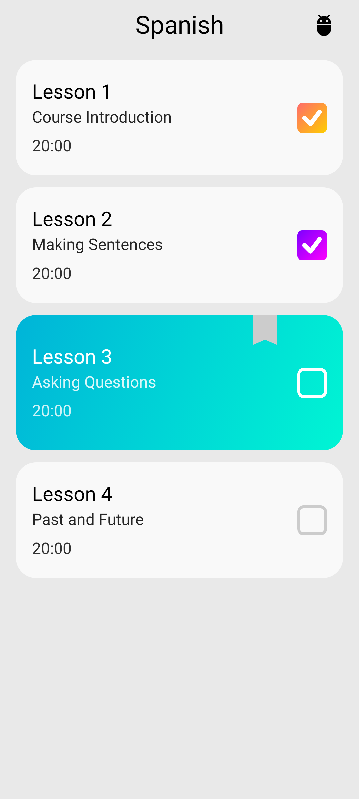
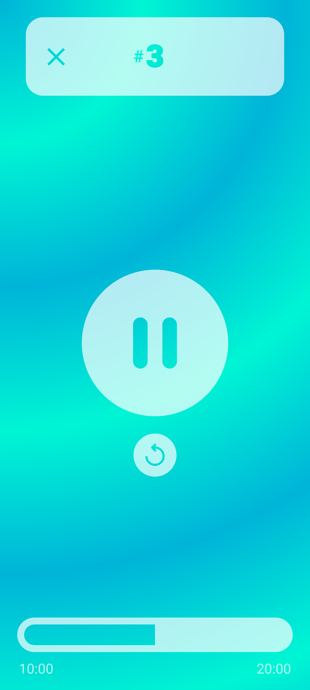

<!-- Generated from readme.yml by LukeNeedham/ci-workflows (docs/readme.md). Edit readme.yml, not this file. -->
<p align="center">
  
</p>

# LT Companion

An unofficial Android app for the Language Transfer audio courses.

## Description

LT Companion is an unofficial Android app for [Language Transfer](https://www.languagetransfer.org/), an audio-based
language course. It downloads the course (currently Spanish only), plays the lessons, and pauses itself at the
"pausepoints" where the teacher asks a question, so you have time to think of the answer before the recording
carries on. Lessons you have finished are ticked off on the home page, which scrolls to the one you are up to, and
you can report a pausepoint that is missing, unnecessary, too early or too late from inside a lesson.

## Screenshots




## Getting started as a user

1. Install the latest build from the [AppHub](https://www.lukeneedham.com/apphub) app, or download the APK from the [Releases](https://github.com/LukeNeedham/LT-Companion/releases) page.
2. On the first run the app downloads the Spanish course audio; keep it open until the download completes.

Requires Android 6.0 (API 23) or newer.

## Getting started as a developer

Requirements: JDK 17 and the Android SDK (platform 36), for example through Android Studio.

```
git clone https://github.com/LukeNeedham/LT-Companion.git
cd LT-Companion
./gradlew assembleDebug    # the APK is in app/build/outputs/apk/debug/
./gradlew test             # unit tests
```

Every pull request is built by CI, which comments on it with a link to install the APK.

Like all my apps, it follows the shared architecture and conventions (single activity, Jetpack Compose, Navigation 3, MVVM with every page split into a `Page` and a `PageContent`, Koin): see [ci-workflows](https://github.com/LukeNeedham/ci-workflows/blob/main/docs/new-app.md).

The pausepoints and lesson names the app uses are the JSON assets in `app/src/main/assets/pausepoints/` and
`app/src/main/assets/lessonnames/`. They are generated by an offline Python pipeline in `languagedata/`, separate
from the Gradle build: `process.py` reads the raw Language Transfer audio (in the gitignored
`languagedata/audiosource/<language>/`, unzipped from
`https://downloads.languagetransfer.org/<language>/<language>.zip`) and asks the Gemini API for the pausepoints,
so it needs a gitignored `languagedata/local.properties` with `GEMINI_API_KEY=...`. See `languagedata/README.md`.
Only touch it to regenerate or adjust that data.

## Contributing

Branch from `main`, make the change, and open a pull request. CI must be green before it is merged.

## License

All rights reserved. See [LICENSE](LICENSE).
